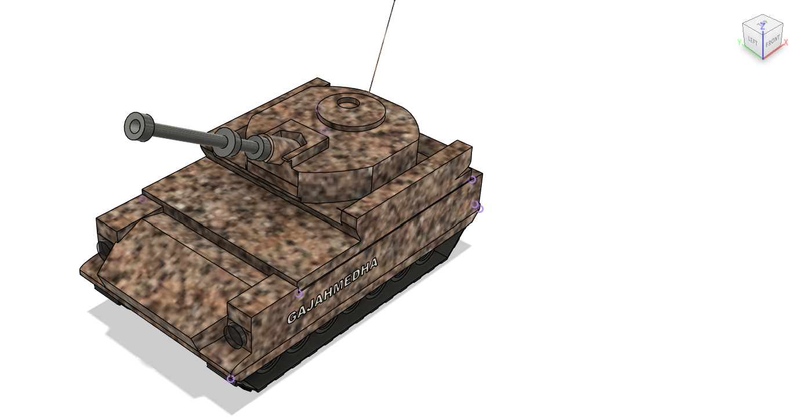

# GAJAHMEDHA-3D-Military-Tank
A 3D military tank model designed in Autodesk Fusion 360 as my 1st semester college project.
## 🚀 Interactive 3D Model

Explore my Ghajameda military tank model designed using Autodesk Fusion 360.

[🔗 View Interactive 3D Model](https://dhivigneshtarigopula.github.io/GAJAHMEDHA-3D-Military-Tank/3d-model.html)

# Photos to my model

  

  
  

